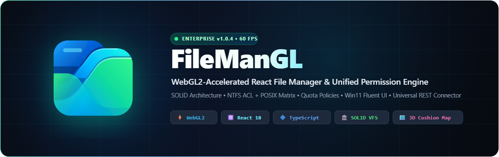
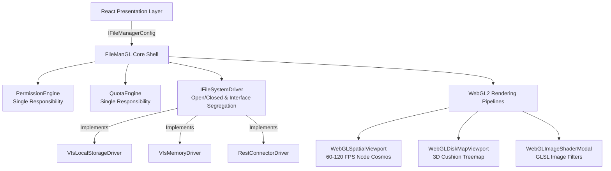

<div align="center">



# FileManGL

### Next-Gen WebGL2-Accelerated React File Manager & Enterprise Unified Permission Engine

[](https://reactjs.org/)
[](https://www.typescriptlang.org/)
[](https://vitejs.dev/)
[](https://www.khronos.org/webgl/)
[](https://tailwindcss.com/)
[](https://vitest.dev/)
[](LICENSE)

<p align="center">
  <a href="#-overview">Overview</a> •
  <a href="#-key-features">Key Features</a> •
  <a href="#-architecture--solid-principles">Architecture</a> •
  <a href="#-webgl2-visualizations">WebGL2 Visualizations</a> •
  <a href="#-hybrid-security--permission-engine">Security &amp; Permissions</a> •
  <a href="#-vfs-drivers--universal-backend-connector">VFS Drivers</a> •
  <a href="#-getting-started">Getting Started</a> •
  <a href="#-project-structure">Project Structure</a>
</p>

</div>

---

## 🌟 Overview

**FileManGL** (formerly *HyperionFM*) is a high-performance, enterprise-grade React file management ecosystem engineered to bridge the gap between traditional web file pickers and desktop-class operating systems.

Combining a **Windows 11 Fluent UI / macOS hybrid interface** with **hardware-accelerated WebGL2 rendering pipelines**, FileManGL fluidly navigates workspaces containing tens of thousands of items at **60–120 FPS**. It ships with a clean **SOLID architecture**, decoupled storage drivers, comprehensive **NTFS-style ACL + POSIX permission matrices**, granular **quota policies**, and an extensible **Universal Backend Connector Protocol** compatible with any RESTful backend (Node.js, Go, Laravel, Python, .NET).

<div align="center">
  
</div>

---

## ✨ Key Features

### 🖥️ Desktop-Class Fluent & Glassmorphism UI
- **Windows 11 Explorer Command Bar**: Context-aware actions, breadcrumb path navigation, history forward/backward traversal, search bar, and flexible view layouts.
- **Dual Navigation System**: Collapsible recursive folder tree sidebar combined with high-density grid, list, compact, and 3D spatial viewport modes.
- **Multitasking & Hotkeys**: Multi-item marquee selection, keyboard shortcuts (`Ctrl+A`, `Ctrl+C`, `Ctrl+X`, `Ctrl+V`, `Del`, `F2`), right-click glassmorphic context menus, and inline rename.
- **Drag & Drop**: Native drag-and-drop file organization with visual drop targets and collision safeguards.
- **Bilingual Internationalization (i18n)**: Seamless instant runtime switching between **English** and **Turkish (Türkçe)** with full localization tokens.

### ⚡ WebGL2 Hardware-Accelerated Viewports
1. **Spatial Cosmos Viewport (`WebGLSpatialViewport`)**:
   - Hardware-instanced 3D node scene capable of rendering **10,000+ nodes at 60 FPS**.
   - Multiple spatial distribution algorithms: **Geometric Orthogonal Grid**, **Semantic Category Clusters**, and **Galaxy Logarithmic Spiral**.
   - Interactive zoom, 3D orbiting camera, ray-casted node picking, and dynamic stress test generation.
2. **3D Cushion Treemap Disk Map (`WebGLDiskMapViewport`)**:
   - WinDirStat / WizTree / DaisyDisk-style volumetric disk visualizer.
   - Calculates squarified treemaps where each file's surface area and 3D specular curvature reflect its exact byte footprint on disk.
3. **GLSL Fragment Shader Studio (`WebGLImageShaderModal`)**:
   - Real-time GPU image processing studio powered by customizable GLSL fragment shaders (inversion, color grading, sharpening, edge detection, and chromatic aberration).

### 🛡️ Hybrid Enterprise Security Matrix
- **NTFS-Style Fine-Grained Access Control Lists (ACL)**:
  - Role and user-specific rules: `read`, `write`, `delete`, `rename`, `upload`, `download`, `share`, `chmod`, `lock`.
  - Recursive permission inheritance (`inheritFromParent`) across directories.
- **POSIX Octal Compatibility**:
  - Full support for standard UNIX octal permission masks (`0755`, `0777`, `0644`, etc.) with user, group, and other bit calculations.
- **Directory & Volume Quota Engine**:
  - Real-time enforcement of volume storage limits (`maxBytes`).
  - Folder-level quotas: Maximum file size restrictions, file count caps, and strict MIME type / extension whitelists & blacklists.

### 🔌 Universal Virtual File System (VFS)
- Decoupled via **Dependency Inversion (DIP)** and **Liskov Substitution (LSP)**.
- **`VfsLocalStorageDriver`**: Full offline client-side virtual file system with local storage persistence.
- **`VfsMemoryDriver`**: Ultra-fast ephemeral RAM-disk driver ideal for unit testing and kiosk sessions.
- **`RestConnectorDriver`**: Universal HTTP JSON connector ready to plug into any backend.

---

## 🏛 Architecture & SOLID Principles



- **Single Responsibility Principle (SRP)**:
  - `PermissionEngine.ts`: Exclusively computes security access tokens, octal conversions, inheritance chains, and lock flags.
  - `QuotaEngine.ts`: Exclusively monitors storage consumption, file counts, and extension validation rules.
- **Open/Closed Principle (OCP)**:
  - New storage drivers, custom viewports, or file viewers can be added by implementing standard TypeScript interfaces without touching existing business logic.
- **Liskov Substitution Principle (LSP)**:
  - `VfsLocalStorageDriver`, `VfsMemoryDriver`, and `RestConnectorDriver` can be swapped interchangeably at runtime through `IFileSystemDriver`.
- **Interface Segregation Principle (ISP)**:
  - Modular contract definitions in `src/core/contracts/types.ts` prevent bloated signatures.
- **Dependency Inversion Principle (DIP)**:
  - High-level explorer orchestrators depend on `IFileSystemDriver` abstractions rather than low-level network or storage details.

---

## 🎨 WebGL2 Visualizations

| Mode | Technology | Description |
| :--- | :--- | :--- |
| **Spatial Cosmos** | WebGL2 Instancing + GLSL | Navigates massive file hierarchies in 3D space with continuous orbit controls and raycast hover detection. |
| **Cushion Treemap** | WebGL2 Specular Shaders | Visually highlights large files, redundant video files, and system bloat using 3D paraboloid cushion maps. |
| **GLSL Shader Studio** | Fragment Shaders | Provides instant in-browser GPU image adjustments, convolutions, and procedural filtering. |

---

## 🔒 Hybrid Security & Permission Engine

### POSIX & ACL Permission Mapping

```typescript
// Inspect permissions programmatically
import { permissionEngine } from './core/services/PermissionEngine';

const canWrite = permissionEngine.canPerformAction(fileNode, 'write', userContext);
const posixSummary = permissionEngine.getPosixString(fileNode.security.posix); // e.g., "-rwxr-xr-x"
const octalValue = permissionEngine.getPosixOctal(fileNode.security.posix);    // e.g., "0755"
```

### Folder Quota Enforcement

```typescript
import { quotaEngine } from './core/services/QuotaEngine';

const validation = quotaEngine.validateUpload({
  targetFolder: parentNode,
  incomingFileSize: 15 * 1024 * 1024, // 15 MB
  incomingFileName: 'dataset.csv',
  currentVolumeUsedBytes: 450 * 1024 * 1024,
  volumeMaxBytes: 1024 * 1024 * 1024 // 1 GB Total
});

if (!validation.allowed) {
  console.error(`Upload blocked: ${validation.reason}`);
}
```

---

## 🔌 VFS Drivers & Universal Backend Connector

FileManGL includes an open HTTP JSON wire protocol for remote backend integration:

### Protocol Command Matrix

| Command (`cmd`) | Arguments | Description |
| :--- | :--- | :--- |
| `open` / `ls` | `{ path: string }` | Enumerate files and directories with ACL, POSIX, and quota metadata. |
| `mkdir` | `{ path: string, name: string }` | Create directory with permission validation. |
| `mkfile` / `upload` | `{ targetPath: string, file: File }` | Write file validating quota policy, extension rules, and max file sizes. |
| `paste` | `{ sourceIds: string[], targetPath: string, mode: 'copy'\|'cut', conflict: 'replace'\|'keep_both'\|'skip' }` | Move or duplicate nodes with customizable collision strategies. |
| `rename` | `{ id: string, newName: string }` | Rename file or folder with regex sanitation. |
| `chmod` | `{ id: string, acl: AclRule[], posix: string, locked: boolean }` | Mutate permission bits, security flags, or quotas. |
| `archive` / `extract` | `{ sourceIds: string[], archiveName?: string }` | Compress selected items to `.zip` or uncompress archives. |

---

## 🚀 Getting Started

### 📦 Install via NPM / PNPM / Yarn / Bun / NPX

```bash
# Install into an existing React (>=18) project
npm install filemangl
# or
pnpm add filemangl
yarn add filemangl
bun add filemangl
```

### ⚡ CLI Quick Scaffold (`npx filemangl` / `npmx filemangl`)

```bash
# Generate a ready-to-use <FileManGLWorkspace /> component in your project
npx filemangl init

# Scaffold a brand-new Vite + React + TypeScript + FileManGL starter app
npx filemangl create my-cloud-drive

# Run environment & package diagnostics
npx filemangl doctor
```

### 🧩 Usage in React

```tsx
import React, { useState } from 'react';
import {
  FileManGL,
  I18nProvider,
  DEFAULT_FILE_MANAGER_CONFIG,
  type IFileManagerConfig,
} from 'filemangl';
import 'filemangl/style.css';

export default function App() {
  const [config, setConfig] = useState<IFileManagerConfig>({
    ...DEFAULT_FILE_MANAGER_CONFIG,
    locale: 'tr', // 'tr' | 'en' | 'de' | 'ru'
    theme: 'dark', // 'dark' | 'light'
    driverType: 'vfs_localstorage',
  });

  return (
    <I18nProvider
      locale={config.locale}
      onLocaleChange={(locale) => setConfig((prev) => ({ ...prev, locale }))}
    >
      <FileManGL
        config={config}
        onConfigChange={(patch) => setConfig((prev) => ({ ...prev, ...patch }))}
      />
    </I18nProvider>
  );
}
```

### Prerequisites (Local Repository Development)
- **Node.js**: `v18.0.0` or higher (tested on Node v20 & v24)
- **Package Manager**: `npm`, `pnpm`, or `yarn`

### Clone & Local Development

```bash
# Clone the repository
git clone https://github.com/umitunc/filemangl.git

# Enter project directory
cd filemangl

# Install dependencies
npm install
```

### Development Server

Start Vite local development server with hot module replacement (HMR):

```bash
npm run dev
```

Visit `http://localhost:5173` in your browser.

### Production Build

Type-check with TypeScript compiler and build optimized production bundle:

```bash
npm run build
```

Preview production build locally:

```bash
npm run preview
```

### Running Tests

Execute the Vitest test suite:

```bash
# Run all unit and integration tests
npm test

# Run tests in interactive watch mode
npm run test:watch
```

---

## 📁 Project Structure

```
filemangl/
├── docs/
│   └── logo/
│       ├── filemangl-banner.png      # High-res GitHub banner
│       ├── filemangl-banner.svg      # Scalable vector banner
│       ├── filemangl-logo.svg        # Scalable 3D folder logo
│       ├── filemangl-logo.png        # 512x512 logo
│       ├── filemangl-logo-512.png    # High-density icon
│       ├── filemangl-logo-192.png    # Mobile & standard icon
│       └── favicon.ico               # Multi-size Windows & web icon
├── public/
│   ├── favicon.svg                   # Modern SVG favicon
│   ├── favicon.ico                   # Multi-resolution ICO (16, 32, 48, 64)
│   ├── favicon-32x32.png             # Standard browser tab icon
│   ├── favicon-16x16.png             # Legacy browser tab icon
│   └── apple-touch-icon.png          # iOS home screen bookmark icon
├── scripts/
│   └── generate_assets.py            # Headless vector & raster icon generator
├── src/
│   ├── components/
│   │   ├── brand/
│   │   │   ├── HyperionLogo.tsx      # Interactive 3D layered logo component
│   │   │   └── LanguageDropdown.tsx  # Internationalization language selector
│   │   ├── configurator/             # Settings, driver selectors & quota inspector
│   │   ├── docs/                     # In-app architecture & API documentation
│   │   ├── explorer/                 # Toolbar, AddressBar, FolderTree, FileGrid, DetailsPane
│   │   └── modals/                   # Chmod/ACL, Batch Rename, Archive, Shader, Previews
│   ├── core/
│   │   ├── contracts/                # SOLID TypeScript types & abstract interfaces
│   │   ├── drivers/                  # VfsLocalStorageDriver, VfsMemoryDriver, RestConnector
│   │   ├── services/                 # PermissionEngine, QuotaEngine
│   │   └── webgl/                    # WebGLSpatialViewport, WebGLDiskMap, WebGLShaderModal
│   ├── tests/                        # Vitest comprehensive unit & UI test suites
│   ├── App.tsx                       # Main application coordinator
│   ├── index.css                     # Tailwind CSS & glassmorphic custom theme
│   └── main.tsx                      # React root entry point
├── BACKEND_INTEGRATION_GUIDE.md      # Detailed backend integration guide
├── package.json                      # Project manifest
├── tailwind.config.js                # Tailwind styling configurations
├── tsconfig.json                     # TypeScript compiler configuration
└── vite.config.ts                    # Vite build configuration
```

---

## 🧪 Quality & Test Coverage

The project is backed by comprehensive automated test suites using **Vitest** and **React Testing Library**:

- ✅ **Core Security & Permission Tests**: Verification of ACL resolution, POSIX bitmask calculation, recursive folder inheritance, and locked node protection.
- ✅ **Quota Engine Tests**: Validation of volume-level caps, folder byte limits, allowed/disallowed extensions, and file-count barriers.
- ✅ **Explorer Interaction Tests**: Selection state, breadcrumb routing, keyboard navigation, sorting, and inline search.
- ✅ **i18n & Localization Tests**: Verification of dual-language switching (English & Turkish) and persistent locale state.
- ✅ **WebGL & Modal Integration Tests**: Canvas context resilience, fallback gracefully when WebGL2 context is mocked or unsupported.

---

## 🤝 Contributing

Contributions, issues, and feature requests are welcome!

1. Fork the Project (`https://github.com/umitunc/filemangl/fork`)
2. Create your Feature Branch (`git checkout -b feature/AmazingFeature`)
3. Commit your Changes (`git commit -m 'Add some AmazingFeature'`)
4. Push to the Branch (`git push origin feature/AmazingFeature`)
5. Open a Pull Request

---

## 📄 License

Distributed under the **MIT License**. See [`LICENSE`](LICENSE) for more details.

---

<div align="center">
  <sub>Engineered with precision by <a href="https://github.com/umitunc">Ümit Tunç</a></sub>
</div>
